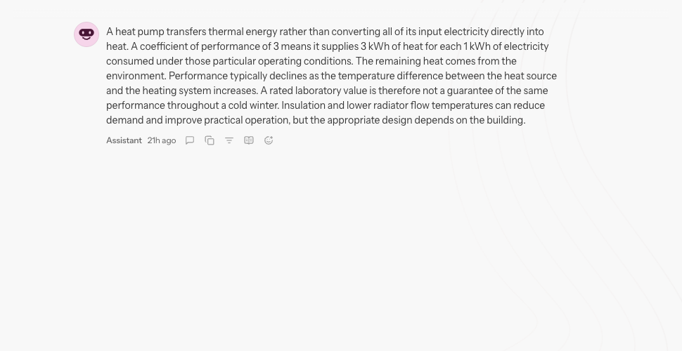
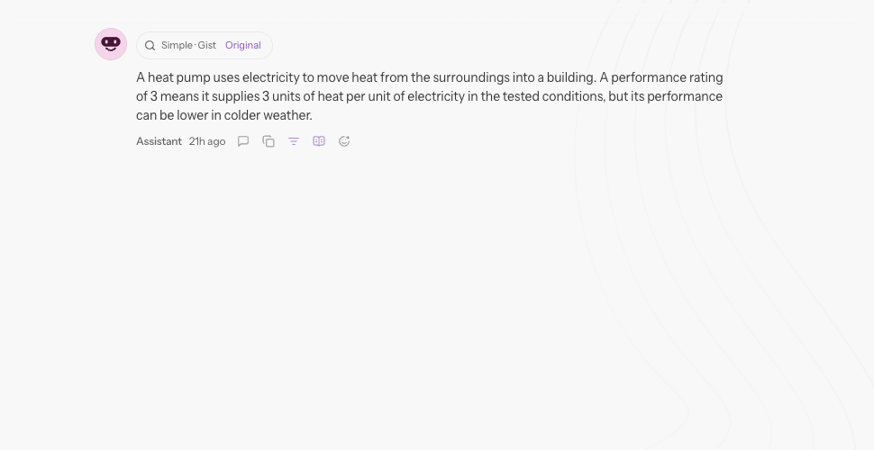

# Answer Lens preview

An isolated built Control UI with a real Gateway and utility model. Synthetic heat-pump prose only. The 22-second clip is real speed: Original → Simple Full → Shorter → Gist → Original. Original restoration was checked byte-for-byte.

[Play/download the transition video](answer-lens-transitions.mp4)

## Longer walkthrough

[Play/download the 39-second length and complexity demo](answer-lens-long-demo.mp4)

A separate user-recorded walkthrough using a car explanation. Original recording preserved.

## Original

## Simple Gist

The original conversation is unchanged; only the displayed version changes. This is behavioral preview evidence, not a claim of universal model fidelity.
