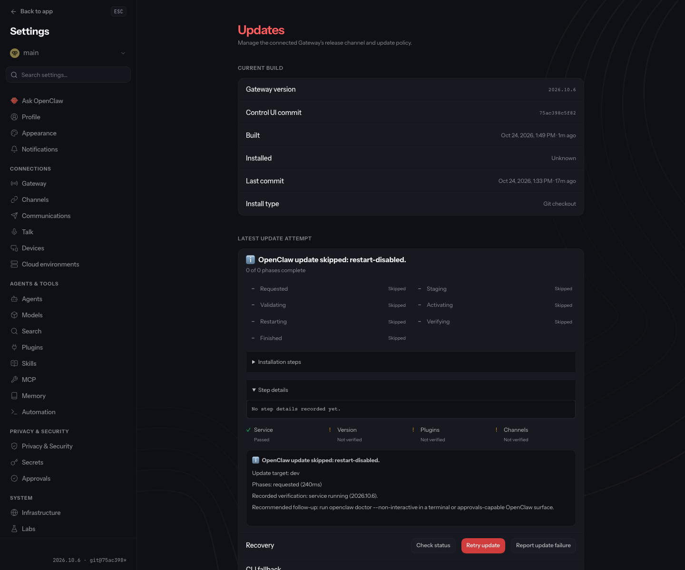
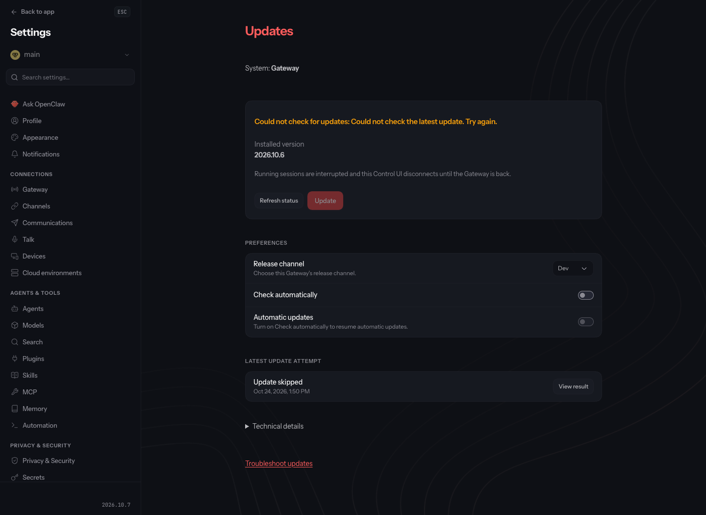
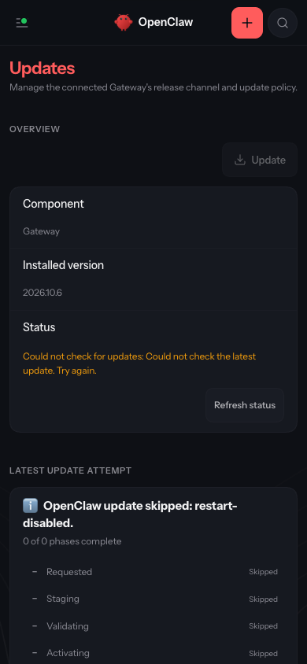
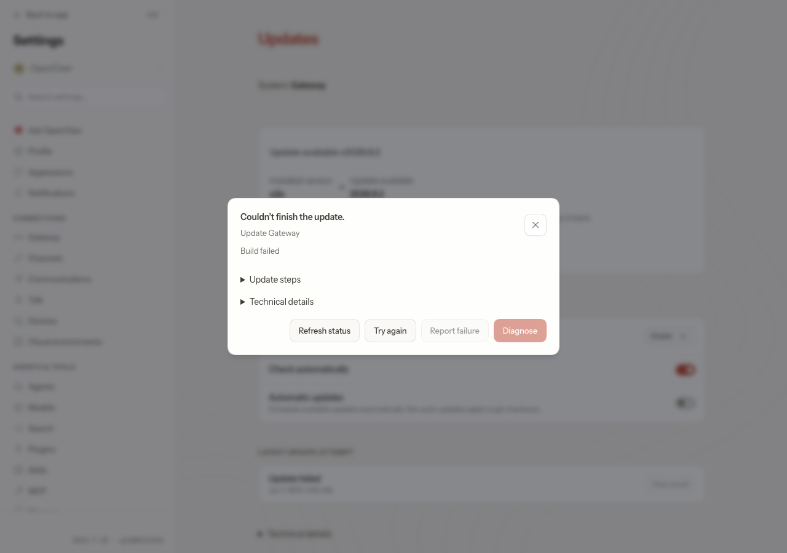
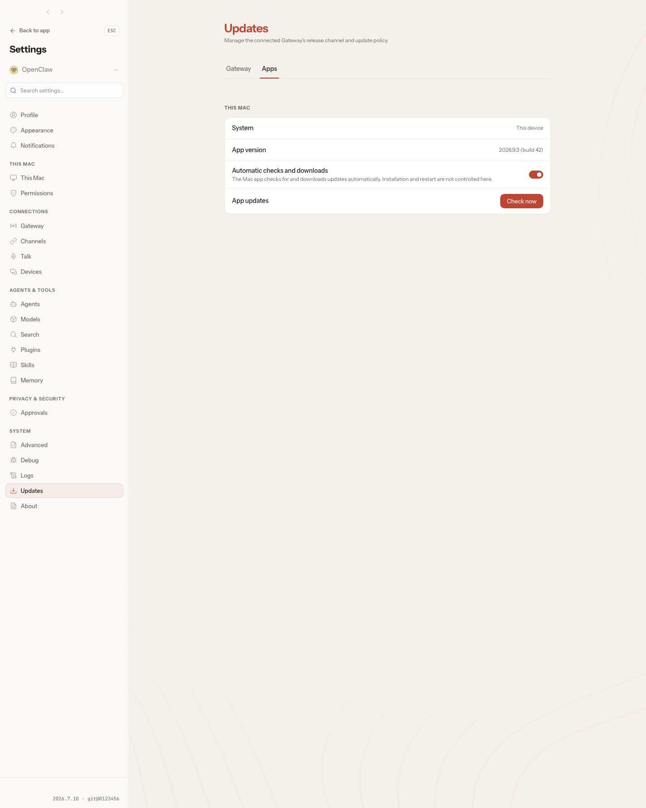

# Updates UI review evidence

Product source: `97355b465fd7920e3dc8c0ee64592f85339b2cfc`. Baseline: `75ac398c5f8248c16cd92c263834bdf2f94dc43a`. This is a proof-only branch, not an installable OpenClaw release or part of the product PR.

## Setup and limits

Desktop and narrow captures use the production UI build with a real isolated loopback Gateway, no production credentials/plugins/channels, and restart disabled. The retained refusal is intentional; no update installation ran. The isolated Git checkout cannot discover its update target, so its visible check error is genuine.

Failure screenshot: deterministic mocked Gateway, failed staging, four visible recovery actions; unavailable actions are disabled by the fixture permissions. Apps screenshot: deterministic native bridge fixture, existing check/download policy only. Neither proves native installation or a model-backed diagnosis.

All24 affected browser scenarios passed across scoped runs; final committed-head confirmation rerun14/14. Focused tests, UI types, changed-file lint/format, stylesheet lint, keyless i18n and UI build passed. Equal-inventory base/head gzip: startup282279/282298 (+19B, within64B build variance); chat1277371/1277370 (-1B). Absolute base budget warnings remain.

The build's dirty marker came from pnpm's incidental lock metadata; product UI source matches the commit and that lock change is excluded. Main was checked for overlapping update-path changes before publication.

## before.png

## after.png

## mobile.png

## failure.png

## apps.png

