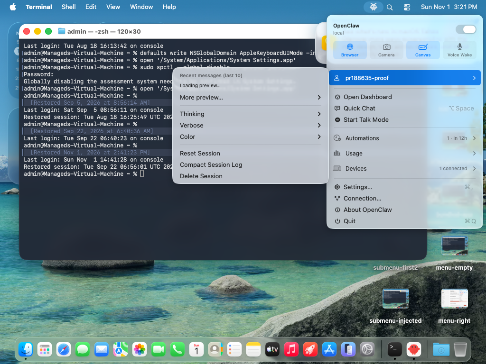
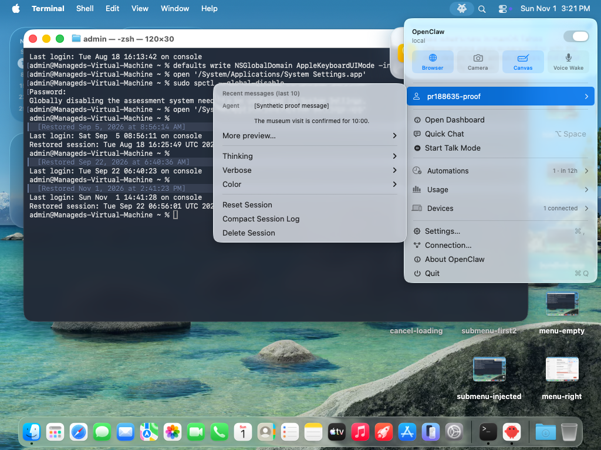
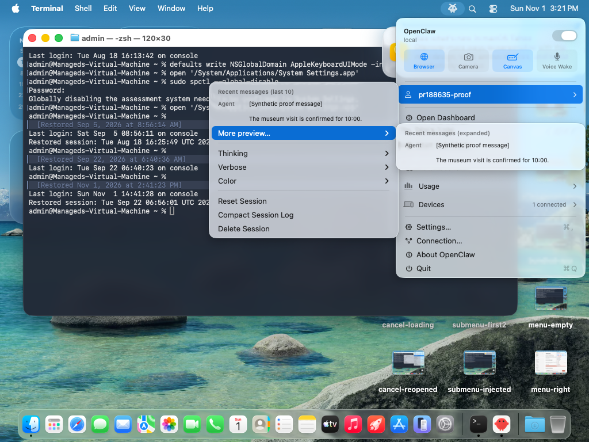

# PR #188635 — unmodified final-head macOS app interaction (1 November 2026)

Published PR head: `0fb8f65de80660a12516a24f1376438908159234`. Disposable, credentialless macOS 26.6.2 Tart guest with Xcode 27.0. No operator home/config/credentials or live Gateway mounted; clipboard, audio and USB disabled. The guest received a `git archive` of the exact head and later fetched only Git metadata/blobs for packaging. `git rev-parse HEAD`, the app's `OpenClawGitCommit`, and the current PR head all report the same SHA. `git diff --exit-code` passed for the three changed Swift files. No source/test overlay was applied.

Build: frozen-lockfile `pnpm install --ignore-scripts`, `node scripts/prepare-apple-mermaid.mjs`, native Swift product build, then `scripts/package-mac-app.sh` with `SKIP_PNPM_INSTALL=1 OPENCLAW_SKIP_MLX_TTS=1 ALLOW_ADHOC_SIGNING=1 BUILD_ARCHS=arm64 GIT_COMMIT=<head>`. The debug bundle passed deep strict codesign verification. Its native executable SHA-256 is `b44d1b7d7d545cf116f9b0437065bdc9eb3820a2f2dafb2c18fb0d7d89a913e6`. The omitted MLX voice helper is unrelated to the menu; this is not a release/notarized app.

A fresh guest-only `prproof` profile ran the packaged app and its own app-managed Gateway on loopback. A session was created through `sessions.create`; `chat.inject` inserted the clearly labeled synthetic message “The museum visit is confirmed for 10:00.” No external model/account/channel was used. The app rendered the real root menu, retained session submenu, compact preview, and expanded preview.

Two observed transitions, using only guest desktop input and `SIGSTOP`/`SIGCONT` on the guest Gateway to hold/resume responses (no app/source changes):

1. After waiting >30 seconds for preview cache expiry, pause the guest Gateway, right-click the app status item and hover the session. `expired-loading.png` shows `Loading preview…` synchronously. Resume the Gateway; `expired-recovered.png` shows the synthetic message in the same submenu.
2. After another >30 seconds, pause the guest Gateway, reopen and hover the session. `cancel-loading.png` shows `Loading preview…`. Click outside to close the tracked root menu before the Gateway can reply. Resume the Gateway, reopen and hover. `cancel-reopened.png` shows the synthetic message; `expanded-after-reopen.png` shows the same message in both compact and expanded previews.

The command sequence and inspected screenshots establish the visible unmodified-app behavior under controlled backend delay. The screenshots do not independently count wire requests or establish that a late cancelled response reached the cache; the published-head focused native suite covers cancellation/lease controls separately. This proof does not claim full native CI, a notarized/released app, personal-data operation, or a rating change.

## Inspected captures

Expired-cache projection while response held:

After the Gateway resumes:

Cancellation/reopen, before closing the root menu:

After closing, resuming the Gateway, and reopening:

Both compact and expanded hosted previews:

