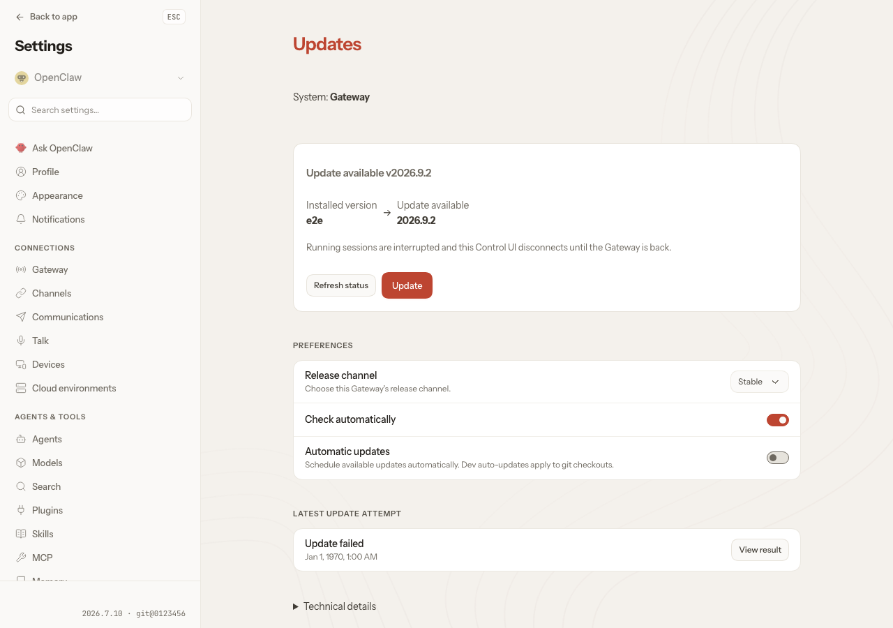
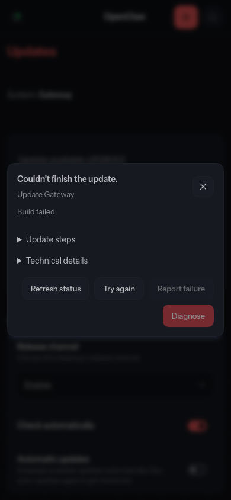

# Updates UI correction evidence

Source candidate: `56cce017b066ed3751fab038c68917919ba96264`. This proof-only branch is not an installable release or part of the product diff.

## Capture boundaries

Before: isolated Gateway at75ac398c5f8248c16cd92c263834bdf2f94dc43a. After/mobile: corrected production UI served by a real credential-free isolated loopback Gateway. The genuine update-target check error and retained restart-disabled refusal are shown; no installation ran. These captures precede the final sidebar-only callback dedup and test-conflict rebase; no captured component layout changed.

Available/failure/narrow failure: actual production-component renders against deterministic Gateway fixtures. Apps: deterministic native bridge fixture. Disabled recovery actions reflect fixture permissions. These do not establish native installation or model-backed diagnosis. Gateway/Apps styling reuses existing UI primitives; unsupported remote inventory and native installation policy are deliberately not simulated.

The current browser tests exercise report preview and browser handoff, diagnosis, retained attempts and absence of unintended update calls. Independent visual/source re-review accepted the corrected compact card, preference ordering, single outcome title and two terminal disclosure groups.

## Before

## Corrected real Gateway

## Available update fixture

## Failure fixture

## Narrow failure fixture

## Apps fixture

## Narrow real Gateway

## Validation

Final-base production UI typecheck passes. Ten affected browser scenarios pass across the rebase run and one targeted selector-fix rerun. Previously frozen source:78 focused unit tests and11 report/diagnosis browser scenarios pass. Final-base performance passes: chat startup1273935→1273858B gzip (−77B), CSS+62B raw/+15B gzip, budgets unchanged. No full-repository test pass or hosted-CI readiness is claimed here.
