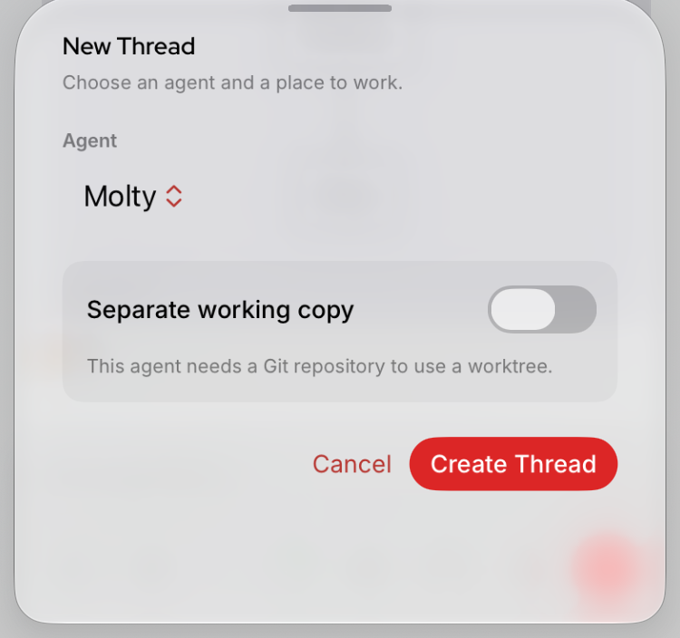
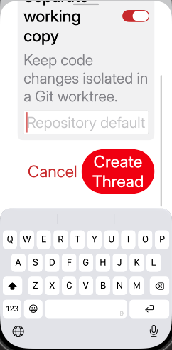
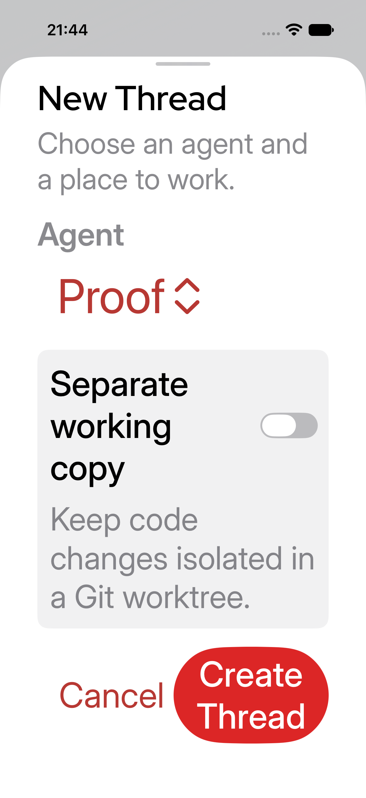
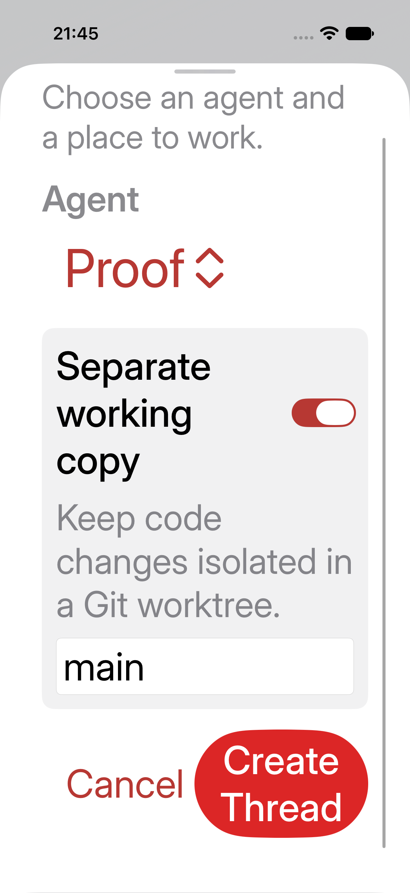
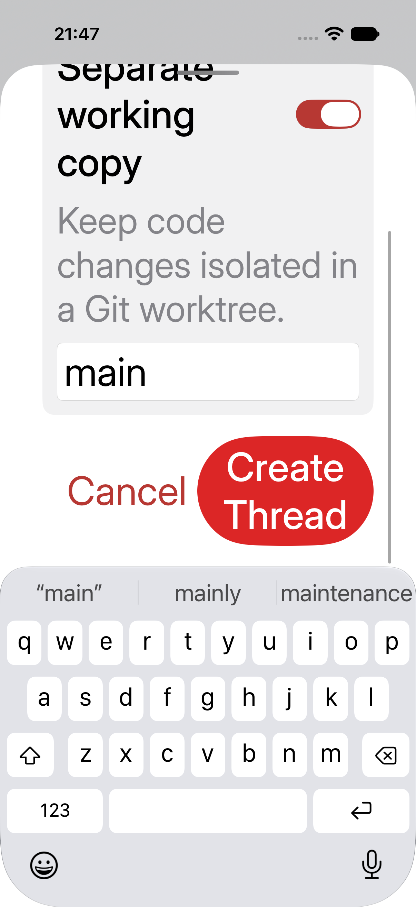

# PR #193600 native layout comparison

These are privacy-cropped screenshots of the New session options sheet only, captured manually in Device Hub on the same iPhone 17 simulator, iOS 27.2, at accessibility XXXL. The fixture agent is Molty, with `workspaceGit=false`; the keyboard was hidden and Separate working copy was off. The crop deliberately excludes the chat behind the sheet.

- `main-iphone17-xxxl.png`: production Swift files at current-main `9f07ae4789dc727d992b61208ed06601633cb013`; title is above the fixed medium sheet, the toggle label is truncated, and Cancel is below the visible sheet.
- `candidate-iphone17-xxxl.png`: layout commit `eef431bac6f8442085edcfc82c7a45dd8079bda2`; title, explanation, full toggle label and actions are visible in the large sheet. A manual Cancel tap dismissed the sheet, but that action is not depicted in this still image.

The later task tip `612140c312ec5bb1f8cb8619b587fb67f4b8e9a4` and Robo's published PR head `e767a466cd5691b82b27dec8d58c2ec4fed82369` preserve the same production layout blob.

`candidate-xcuitest-iphone17-xxxl.png` is the screenshot attachment from a separate, exact-source `xcodebuild test` run on iPhone 17 / iOS 27.2 at accessibility XXXL. The focused `AdaptiveLayoutUITests.testNewSessionOptionsRemainReachableAtAccessibilitySize` passed 1/1 on 5 November 2026 at 20:50 CET after recompiling the test target from task tip `612140c312ec5bb1f8cb8619b587fb67f4b8e9a4`. Its geometry attachment recorded window `(0,0,402,874)`, title `(41,82,208.7,50.3)`, hittable Cancel `(64.7,738.3,116,46)`, and Create Thread `(190.7,708.3,170.3,106)`; the test tapped Cancel and observed dismissal. The local result bundle is `exact-source-ui-test.xcresult` under Engineering's private `pr193600-native-20261105` artifact. This is a focused simulator test, not a full suite or real Gateway effect.

These images and the focused test do **not** establish real working-copy ON, keyboard entry, or Create Thread effects against a Gateway. Separate local synthetic-fixture observations cover ON and keyboard layout only.

## Matching automated baseline red

At 21:05 CET, Engineering restored **only the two production Swift files** to current-main `9f07ae4789dc727d992b61208ed06601633cb013`, keeping the same focused UI test source, device, runtime, accessibility size and Xcode 27.2 setup. A fresh `xcodebuild test` failed **1/1 on the original visual behavior**: `New Thread title is not visible` at `AdaptiveLayoutUITests.swift:48`. The baseline attachment recorded window `(0,0,402,874)`, title `(47.4,335.3,200.4,48.3)` with `isHittable=false`, and Cancel starting at `y=840.1` with height `44.2`, extending past the 874-point window. The local result bundle is `exact-source-baseline-red.xcresult` under the same private artifact. The test and production sources were restored to the candidate tip afterward; the worktree was clean. The uncropped XCTest screenshot includes unrelated fixture chat and is **not public**.

Together with the rebuilt candidate green above, this is a matching focused automated red/green for the iPhone 17 accessibility XXXL sheet. It does not broaden the scenario or prove real Gateway effects.

## Smaller iPhone automated check

`candidate-xcuitest-se3-xxxl-initial.png` is the initial screenshot attachment from the same exact-source focused test on an iPhone SE (3rd generation), iOS 27.2, accessibility XXXL, at 21:11 CET. The 375×667-point viewport initially shows the title, explanation and toggle; Cancel/Create Thread start below the visible window (Cancel `y=696.5`, not initially hittable). The test then swiped the form until both actions were contained and Cancel was hittable, tapped Cancel, observed dismissal, and **passed 1/1 in 16.57 seconds**. This is smaller-viewport reachability proof, not a claim that all controls fit without scrolling. It remains fixture-only and does not verify real Gateway effects.

## Additional proof — 5 November, 21:33 CET

Production source: task tip `612140c312ec5bb1f8cb8619b587fb67f4b8e9a4`; both affected production files match PR head `e767a466cd5691b82b27dec8d58c2ec4fed82369`. No product-code change was needed.

### Smaller iPhone, default text

Fresh Xcode 27.2 `xcodebuild test` on iPhone SE (3rd generation), iOS 27.2, light appearance, 375×667-point viewport: **1/1 passed in 14.135 seconds**, at 21:33:18 CET. The original focused regression harness was temporarily changed only to select `UICTContentSizeCategoryL` instead of accessibility XXXL, and retain an extra screenshot immediately before Cancel. No production code or fixture data changed for this run; the original test file was restored afterward and the worktree was clean.

```sh
xcodebuild test -project apps/ios/OpenClaw.xcodeproj -scheme OpenClawUITests \
  -destination 'platform=iOS Simulator,id=<owned-SE3-device>' \
  -derivedDataPath <private-proof>/DerivedData \
  -only-testing:OpenClawUITests/AdaptiveLayoutUITests/testNewSessionOptionsRemainReachableAtAccessibilitySize \
  -resultBundlePath <private-proof>/se3-default-automated.xcresult
```

The geometry attachment records window `(0,0,375,667)`, title `(34.3,331.1,73.7,18.2)`, Cancel `(172.2,562.8,44.0,16.3)` with hittable=true, and Create Thread `(225.8,556.1,114.9,29.7)`. All were contained without scrolling; Cancel dismissed the sheet. Screenshot mode, working copy OFF, keyboard hidden. This tests layout/cancellation, not server-side non-creation.



This screenshot was inspected and cropped to the sheet; unrelated fixture chat and PNG metadata were excluded. The local full xcresult remains private.

### Native iOS typography checks

Rebuilt source-equivalent **OpenClawTypographyTests passed 23/23** on iPhone 17 / iOS 27.2 using Xcode 27.2. Command: `xcodebuild test -project apps/ios/OpenClaw.xcodeproj -scheme OpenClaw -destination 'platform=iOS Simulator,id=<owned-iPhone17-device>' -derivedDataPath <private-proof>/DerivedData -only-testing:OpenClawTests/OpenClawTypographyTests -resultBundlePath <private-proof>/typography-continuation.xcresult`. Local terminal result: `Test run with 23 tests in 1 suite passed after 2.240 seconds`. Both these builds use the same temporary generated no-Watch project described above, not a standard Watch-retaining build.

### Earlier focused shared suite — provenance supplement

The exact command was `PATH=<Node24-bin>:$PATH swift test --package-path apps/shared/OpenClawKit --filter ChatViewModelSessionActionTests`, on task tip `612140c312ec5bb1f8cb8619b587fb67f4b8e9a4` whose shared production blob matches published head. The recorded result is **50/50 passed**. This is macOS-hosted Swift package validation, not a macOS app/popover UI pass or real Gateway proof.

Earlier full-package execution ran 2,492 tests and had three failures, all at `createdParentSessionKeys() == [nil]`: “new trigger starts fresh agent session without admin reset”, “new trigger keeps selected global agent scope”, and “new trigger prefers explicit session agent over ambient agent”. A control restoring the changed shared production file to original main reproduced the three failures. No full-suite pass is claimed.

### Historical synthetic keyboard-visible layout observation

The following inspected crop comes from the earlier 20:12 CET iPhone 17/iOS 27.2/XXXL manual observation. Only the local screenshot agent's `workspaceGit` fixture flag was temporarily enabled; production layout code was unchanged from task tip. Both actions and the base field were scrolled above the **visible software keyboard**; text entry and Cancel dismissal were observed. Fixture changes were restored; there was no real Gateway creation/worktree operation.



This closes only the missing inspectable **synthetic** keyboard-visible layout observation. It must not be described as normal-onboarding, real-Gateway, automated ON coverage, or proof of server-side Cancel non-creation. The top heading has intentionally scrolled out of view in this state.

### Independent reporter evidence

[ellibbe's source report](https://github.com/openclaw/openclaw/pull/193600#issuecomment-6668182174) separately reports same-head iPhone 17 native red/green, default-size control, standard Watch-retaining build, and normal-onboarding/WebSocket-fixture ON/base-field/Cancel without creation/chat-send requests. These are reporter-supplied results, not local Engineering executions. The reporter explicitly does not claim visible-keyboard or real-Gateway creation coverage.

Still open: real-Gateway OFF/ON Create and worktree effects, production-flow keyboard-visible proof, macOS app UI, broad viewport/VoiceOver matrix and full-suite validation. These results do not authorize merge or deployment.

## Real isolated Gateway effects — 21:42–21:45 CET

These are **normal-onboarding native app → real Gateway → persisted session/Git** checks, not screenshot transport or a WebSocket mock. The Gateway was built from task tip `612140c312ec5bb1f8cb8619b587fb67f4b8e9a4`; the app's affected production blobs match PR head `e767a466cd5691b82b27dec8d58c2ec4fed82369`. Xcode27.2, iPhone17/iOS27.2/XXXL/light; the narrowed generated iOS project still omits Watch. All server state, credentials and Git data were disposable and isolated from production. No initial chat message/model run was requested.

- **Cancel:** fresh XCTest passed 1/1 in **27.684s**, at21:42:01. Normal onboarding connected to the owned loopback Gateway; the test opened New session options, verified title/Cancel reachability, tapped Cancel and observed dismissal. Independent read-only SQLite snapshots before and after both reported **0 session heads, 0 session events and 0 worktrees**. The Git repository retained just its original worktree.
- **Create OFF/ON:** expanded temporary harness passed 1/1 in **45.949s** at21:45. It canceled once, created with working copy OFF, then reopened options, enabled working copy, entered base `main`, scrolled until Create was both hittable and fully contained, tapped Create and observed successful dismissal for each mode.
- **Actual backend readback:** three distinct persisted `agent:main:ios-*` session identities and **one** managed worktree. Two sessions were OFF creations (one from a preceding harness run); the third was the successful ON creation. The worktree's `owner_id` matches the ON session, `base_ref=main`, `owner_kind=session`, branch `openclaw/briny-barnacle`. Independent `git rev-parse HEAD` in the worktree equals the disposable repository's `main` commit; worktree `git status --porcelain` is empty. The local JSON retains IDs/path mapping; private filesystem paths are omitted here.
- **First expanded attempt:** OFF creation persisted successfully; the ON step stopped before activation because `isHittable` alone allowed a partially offscreen action, and the subsequent containment assertion failed. The harness was corrected to scroll until full containment as well as hittability. Production code was not changed. Do not call that first attempt a complete pass.




The current ON still does **not** show a visible software keyboard, despite XCTest reporting a keyboard element; it is deliberately named without a keyboard claim. The separate keyboard-visible check below subsequently passed. These runs close real Cancel non-creation and real OFF/ON creation/worktree effects on this one viewport, not broad viewport, full-suite, macOS UI, or VoiceOver coverage.

Commands use `xcodebuild test -project apps/ios/OpenClaw.xcodeproj -scheme OpenClawUITests -destination 'platform=iOS Simulator,id=<owned-iPhone17>' -derivedDataPath <private-proof>/DerivedData -only-testing:OpenClawUITests/AdaptiveLayoutUITests/testNewSessionOptionsRemainReachableAtAccessibilitySize -resultBundlePath <private-proof>/real-gateway-create2.xcresult`. A temporary test-only harness substitutes normal onboarding and actual Create interactions; both production sources and the original regression test are restored on command exit. Raw bundles and logs are private because setup-code entry includes a task-only credential. Public images were inspected and metadata stripped.

### Real software-keyboard qualification — 21:47 CET

A follow-up normal-onboarding/real-Gateway **ON** run passed **1/1 in 63.429s** at21:47:29. The temporary test retained a 25-second coordination pause after base-field entry. During that pause, Engineering invoked Device Hub → Device → Keyboard → Toggle Software Keyboard on the owned simulator; no production app code or host security setting changed. The resulting native screenshot was inspected: the software keyboard is visibly drawn, the base field contains `main`, and Cancel/Create are scrolled fully above it. XCTest asserted full-window containment, Create hittability/enabled state, and `Create.frame.maxY <= keyboard.frame.minY`, then tapped Create and observed successful sheet dismissal.



Backend readback adds exactly **one** session and **one** worktree to the preceding 3-session/1-worktree state: **4 sessions / 2 worktrees total** across all owned attempts. The new worktree is session-owned, branch `openclaw/tender-prawn`, requested base `main`; its HEAD independently equals the disposable repository's main commit. No initial chat turn/model run was sent. Both worktrees were confirmed to use that base. The original production/test sources were restored and the test checkout was clean afterward.

This is an automated native journey with one explicitly recorded human-equivalent Device Hub keyboard toggle—not a fully unattended test, and not a hardware-device or macOS-popover result. It closes the **normal-flow keyboard-visible** gap for this iPhone17/XXXL state. Full-suite validation, macOS popover UI and broader/VoiceOver qualification remain separate. Public evidence contains no setup code/token or private environment path.
